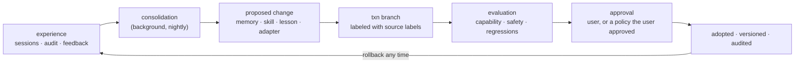

# Growth

How an agent on Fewshot gets better over time — and why it can never grow its way out of oversight.

> **An agent may improve what it knows and how well it works. It may never, by learning, change what it is allowed to do.**

## 1. What can grow

| Kind | Human analogy | What it is | Changes |
|---|---|---|---|
| **Memory** | Remembering | Facts, preferences, project knowledge as typed store objects | What the agent knows |
| **Skill** | Practice | A reviewed, versioned procedure ("how this repo is deployed") the planner can reuse | How the agent approaches a task |
| **Lesson** | Reflection | A post-mortem from a failed or rejected action, linked to its audit entries | What the agent avoids |
| **Adapter** | Physical training | A small weight delta (LoRA) trained on approved local data | How the model thinks |

## 2. What can never grow by learning

Capabilities · delegations · label policies · destination clearances · the gate · the approval surface · the evaluation suites · the growth pipeline itself.

These are changed only by the user or the system manifest, through the trusted path. If an agent could edit its own permissions or its own tests, "getting better" and "escaping oversight" would be indistinguishable — to the user and to the agent.

## 3. The growth loop



1. **Experience** — sessions, the audit log, approvals, corrections and ratings from the user. User feedback is the primary training signal.
2. **Consolidation** — a `background` priority job distills raw sessions into candidate memories, skills and lessons (clustering, deduplication, rewrite). Runs inside a transaction.
3. **Proposal** — every candidate is a typed object with provenance pointing to the sessions it came from.
4. **Labeling** — a candidate's label is the join of its sources. A skill learned from `work:acme` sessions is `work:acme`; an adapter trained on `health` data is `health`. Labels follow it forever (I3 still holds).
5. **Evaluation** — see §4.
6. **Approval** — memories and lessons can be auto-adopted under a user-approved policy; skills and adapters require explicit approval by default.
7. **Adoption** — the object becomes active, its version recorded. Every audit entry notes which memories, skills and adapters influenced the call.
8. **Rollback** — any adopted change can be reverted in one step; the store keeps every version.

## 4. Evaluation

| Suite | Question | Owned by |
|---|---|---|
| **Task evals** | Is the agent measurably better at the tasks this change targets? | Generated from the user's own approved history |
| **Regression evals** | Is it worse at anything it could do before? | System + user |
| **Safety evals** | Do invariant tests and prompt-injection suites still pass at the same level? | System manifest — read-only to agents |
| **Drift checks** | Did behaviour change outside the change's declared scope? | System |

A change that improves task scores but degrades any safety eval is rejected, regardless of approval policy.

## 5. Progressive trust

Supervision relaxes per **task class**, based on the audit record — never on the agent's own claims:

```
new task class ─► every external effect needs approval
N successful sessions, 0 rejected effects ─► user is offered a standing policy
any rejected or rolled-back effect ─► back to full approval for that class
```

Standing policies are user-approved, scoped, expiring, and enforced by the gate. They are the "graduating to heavier weights" step — earned, observable, and revocable.

## 6. Rest and budgets

- Consolidation and adapter training run only at `background` priority, within energy and time budgets, and pause on battery or when the user is active.
- Memory has a size budget; low-value memories decay unless used or pinned by the user.
- The user can inspect, edit, pin, or delete any memory, skill, lesson, or adapter from the shell.

## 7. Scope

Local growth makes *this user's* agent better at *this user's* work. Changes to the base model's capabilities and values come from its developer's training process, not from local learning. Adapters are kept small and scoped so they tune behaviour rather than reshape values; drift checks exist to catch the case where they do.

## 8. Interface

See `Memory`, `Skill`, `Adapter`, `EvalReport`, `Growth` and `GrowthAdmin` in [`interfaces/core.capnp`](../interfaces/core.capnp).
