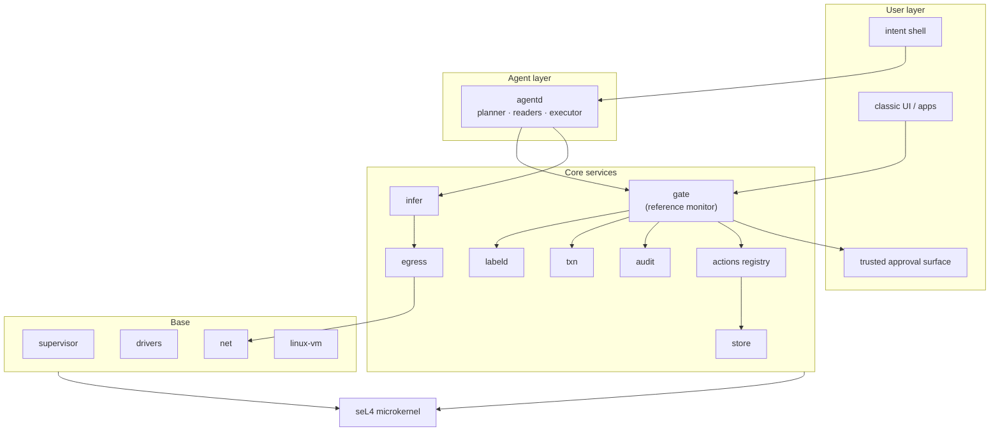
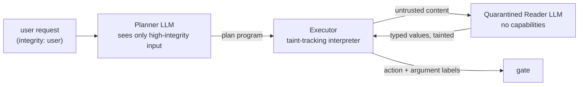

# Architecture

This document describes Arbiter's components, how they interact, and how each one upholds the invariants **I1–I6** defined in the [README](../README.md).

## 1. Layering



Every box is a separate protection domain (its own address space and capability space). The only code running in privileged mode is seL4.

## 2. Kernel: seL4

- **Why:** formally verified for functional correctness and isolation; mature; capability-native. See [ADR-0001](adr/0001-sel4-kernel.md).
- **Configuration:** MCS (mixed-criticality) kernel, so every component runs on a *scheduling context* with a budget and period. This is what makes "the UI never stutters" an enforceable property instead of a hope.
- **Targets:** `x86_64` and `aarch64`. QEMU/VirtIO first, then one reference laptop and one SBC.
- **Kernel provides only:** threads, address spaces, IPC endpoints, notifications, IRQ and IOMMU objects, capabilities. Everything else is user space.

## 3. Base layer

### supervisor
Root of the component tree. Boots from the signed system manifest, creates every component with exactly the capabilities the manifest grants, enforces memory/CPU quotas, and restarts components that fault. A crashed driver is a restart, not a kernel panic.

### drivers
Each driver is an isolated component holding capabilities only to its device's MMIO region, IRQ, and an IOMMU-restricted DMA window. Early hardware support comes from a **Linux driver domain** (see `linux-vm`) exposing devices back to native components over VirtIO.

### net
User-space TCP/IP stack (smoltcp to start). It does not decide *what* may leave the device; it only transmits what `egress` hands it.

### linux-vm
A Linux guest under an seL4 VMM. Two roles:
1. **Driver domain** — reuse Linux drivers until native ones exist.
2. **Legacy apps** — run unmodified Linux software. To Arbiter, the whole VM is one principal with the `untrusted:legacy` integrity label. Agents can interact with it only through an accessibility/screen bridge whose outputs are labeled low-integrity.

See [ADR-0004](adr/0004-linux-compat-via-vm.md).

## 4. Core services

### 4.1 labeld — information-flow labels

Every principal (process, agent session) and every stored object carries a **label** with two parts:

| Part | Meaning | Rule on read |
|---|---|---|
| **Secrecy** — set of tags, e.g. `{health, work:acme}` | Who may eventually see this data | Reader's secrecy ⊇ data's secrecy (taint goes *up*) |
| **Integrity** — a level, e.g. `user > system-app > bounded > third-party > untrusted:web` | How much the data can be trusted to steer actions | Reader's integrity ≤ data's integrity (trust goes *down*) |

- Labels only move in the safe direction automatically. A principal **cannot** lower its own secrecy or raise its own integrity.
- **Declassification / endorsement** happens only via (a) the user through the trusted approval surface, or (b) a *certified transformer* registered in the manifest — e.g. a reader whose output schema is a closed enum or bounded number, which cannot carry free-form instructions.
- Certified transformers *bound* untrusted influence but do not remove it: an injection can still pick which enum value comes out. Their output therefore gets the **`bounded`** integrity level, which may only select among options the user pre-approved (e.g. a folder from an allow-list), never fill open-ended arguments.
- `labeld` is the single source of truth for current labels; `gate`, `store` and `egress` query it.
- **Value table:** every runtime value in an agent session lives in `labeld` with its label and provenance. Agents hold only opaque handles; deriving a new value goes through `labeld`, which computes its label. The gate resolves argument handles itself, so no agent component can misstate a label. See [ADR-0005](adr/0005-labeled-value-handles.md).
- **Per-label encryption keys:** each secrecy tag has its own data key. Deleting a tag's key cryptographically erases every object, cache and adapter carrying it; the same keys scope backup and sync.

Model: decentralized information flow control (Flume/HiStar lineage), simplified to one integrity lattice and a secrecy tag set. See [ADR-0003](adr/0003-information-flow-labels.md).

### 4.2 store — semantic object store

- **Content-addressed, copy-on-write, versioned** object store. Every write creates a new version; history is cheap.
- Objects are **typed** by schemas from `interfaces/`, e.g. `Email`, `Contact`, `Document`, `Event`.
- Every object carries a **label** and **provenance** (which principal created it, from which inputs).
- **Indexes:** full-text, vector embeddings (computed via `infer`), and an entity/relation graph. Queries return only objects the caller's capabilities and labels permit, and reading them updates the caller's label.
- **POSIX view:** a filesystem projection for legacy software and humans who want files.
- **Memory service:** agent memory is just objects in the store, under the user's ownership, inspectable and deletable. (Fewshot's memory model is a good prototype for this layer.)

### 4.3 txn — transactions

Every agent session runs inside a transaction:

```
begin(session) ──► branch of store state
  local writes ──► land on the branch (reversible: I5)
  external effects ──► queued in the session OUTBOX, not executed
commit(session) ──► gate re-checks outbox, approvals collected, effects run in order
abort(session)  ──► branch discarded, outbox dropped
```

- Users can also **roll back a committed session** for local state (the store keeps history). External effects that already happened are listed with their compensating actions where an app declared one.
- **Dry-run** = run the session, show the diff and outbox, abort.
- **Drafts by default:** where an app offers it, an agent's external effect is first a local draft (`mail.draft`, `payment.prepare`). Drafting from tainted data is free; the step that releases a draft is where approval happens.
- **Checkpoints:** long tasks ("send the request, wait for the reply, act on it") place checkpoints in the plan. At a checkpoint the outbox so far is approved and committed and the session continues on a new branch. Multi-effect commits run as **sagas**: if one effect fails, already-executed effects are compensated in reverse order where the app declared a compensation, and the user is shown what could not be undone.

### 4.4 actions — action registry

Apps publish **actions** as Cap'n Proto interfaces with mandatory metadata:

| Field | Purpose |
|---|---|
| input / output types | Typed, validated arguments — no free-text RPC |
| `effect` | `read` · `localReversible` · `localIrreversible` · `external` |
| `integrityFloor` | Minimum integrity the *arguments* must have without approval |
| `egressTags` | Which secrecy tags this action may send off-device |
| `idempotencyKey` | Required for `external` effects |
| `compensation` | Optional action that undoes this one |

The GUI of an app calls the same actions the agent does. An app with no registered actions is only reachable by agents through the low-integrity screen bridge — a deliberate incentive for developers to publish schemas.

### 4.5 gate — reference monitor

The single choke point for every action invocation, human- or agent-initiated:

1. **Capability check** — caller holds a capability for this action (I1).
2. **Label check** — integrity of every argument ≥ `integrityFloor`, otherwise require approval (I2). Secrecy of arguments ⊆ `egressTags` and destination clearance, otherwise deny or require declassification (I3).
3. **Budget check** — the delegation's time, money, rate, and effect-count limits.
4. **Effect routing** — `read`/`localReversible` execute on the txn branch; everything else goes to the outbox.
   - Argument labels are never taken from the caller: the gate resolves argument handles in `labeld` (ADR-0005).
5. **Audit** — append the decision and arguments' provenance to `audit` *before* execution (I4).
6. **Approval** — when required, send a structured request to the trusted approval surface; the gate blocks until the user answers. The approval is a signature over the **invocation digest** (action, resolved arguments, labels, session, nonce); the gate executes only if the digest still matches, and each approval is single-use (ADR-0006).

The gate is small, written in Rust, has no dependency on any model, and is the primary target for formal verification of user space.

### 4.6 audit

Append-only, hash-chained log of every gate decision: principal, delegation chain, action, argument provenance, labels, approval outcome, result. Rendered in the shell as a human-readable timeline ("what did my agent do today and why"). Supports revoking a delegation from any entry.

### 4.7 infer — inference service

- **Model registry:** installed models with metadata (size, modality, context length, local/remote).
- **Scheduler:** NPU/GPU time and KV-cache memory are scheduled resources with priorities and preemption. Interactive requests (the user is waiting) preempt background ones. Built on MCS scheduling contexts plus an accelerator queue.
- **KV-cache manager:** caches are memory objects owned by sessions, swappable, labeled — a cache holding `health` data is itself `health`-tainted.
- **Routing:** local by default. A remote model is an `external` effect: prompts are checked by `egress` against the remote provider's clearance (I3).
- **Interface:** model-agnostic (`generate`, `embed`, `replay`, grammar-constrained output). Apps never bundle their own copy of a shared base model.
- Full design: [INFERENCE.md](INFERENCE.md).

### 4.8 egress

The only component that can hand bytes to `net` for off-device destinations. Each destination (domain, provider, contact) has a **clearance** — the secrecy tags allowed to reach it. Egress compares the data's label against the destination's clearance and denies, or asks the user for declassification.

## 5. Agent layer: agentd

### 5.1 Principals and delegation

An agent session is a principal identified by `(user, agent, session)`. It holds only **delegation capabilities** granted by the user or a parent session:

```
Delegation {
  actions:     set of action capabilities
  scope:       store query / object set it may touch
  effectCeiling: max effect class without approval
  budget:      wall time, money, tokens, call count
  expiry:      absolute deadline
}
```

Delegation is **attenuating only**: a sub-agent's delegation is always a subset of its parent's.

### 5.2 Planner / reader split (prompt-injection containment)



- The **planner** never sees untrusted content. It writes a *plan* — a small, typed program in the plan DSL — referencing untrusted data only by handle.
- The **executor** runs the plan holding only **value handles**. Every value and its label live in `labeld`'s value table; values derived from untrusted content inherit its low integrity there, where the executor cannot change it (ADR-0005).
- **Quarantined readers** process untrusted content (web pages, emails, documents) and return values matching a requested schema. They hold no capabilities: even a fully hijacked reader can only return a wrongly-filled value.
- The gate resolves every argument handle itself, so it sees the true labels even if the executor is compromised. If a tainted value flows into, say, the recipient of `mail.send`, the gate requires approval — no matter what any model "decided" (I2).

This is the CaMeL pattern, but enforced by the OS instead of by an application framework.

### 5.3 Plan DSL

Deliberately small: let-bindings, calls to registered actions, calls to readers with an output schema, bounded loops over collections, conditionals. No eval, no dynamic code. Plans are stored with the session and shown in the audit log.

### 5.4 Growth

Agents improve through memories, skills, lessons and adapters — all proposed, labeled, evaluated, approved and reversible. Learning can never change capabilities, policies or the gate. Full design: [GROWTH.md](GROWTH.md).

Growth is a core service (`growthd`) with two interfaces, split so that the authority to *propose* a change never includes the authority to *adopt* it:

| Interface | Methods | Held by |
|---|---|---|
| `Growth` | `propose` · `evaluate` · `list` · `rollback` | agentd, consolidation jobs (scoped by delegation) |
| `GrowthAdmin` | `adopt` · `reject` | Trusted approval surface only; gate when enforcing a user-approved policy |

- `propose` takes a `GrowthChange` (`memory` · `skill` · `lesson` · `adapter`). Its label is computed by `labeld` as the join of its `sources`; the proposer cannot set it.
- `evaluate` runs the change on a txn branch against task, regression and safety suites and returns an `EvalReport`. Safety suites are manifest-owned and read-only to every agent.
- `adopt` refuses any change whose `EvalReport` shows a safety decrease or drift, regardless of caller.
- `rollback` is available to agents as well as users: undoing a change can only reduce what the agent has learned, never its authority.
- Adopted memories and skills live in `store`; adopted adapters are registered with `infer`. Every `InferResult` and audit entry lists the growth objects that influenced it.

Lifecycle: `proposed → evaluated → adopted | rejected`, and `adopted → rolledBack`.

### 5.5 Designing around model limitations

The executor and gate add mechanisms for known model failure modes: claims with provenance and independent verification, a goal ledger for long tasks, version-checked writes, action postconditions, a dissent reviewer, freshness metadata, plan agreement sampling, and structured refusals. Full design: [LIMITATIONS.md](LIMITATIONS.md).

## 6. User layer

### 6.1 Trusted approval surface (I6)

- Rendered by the compositor in a reserved screen region / layer no other component can draw into or capture.
- Secure attention: a hardware key combo or dedicated gesture always reaches it.
- Shows *structured* facts from the gate — action, arguments, which arguments came from which untrusted source — never model-written prose alone.
- Wording comes from **fixed plain-language templates** per action and refusal type, filled with gate data. Models never write approval text.
- **Batching:** related effects in a session are approved as one decision ("send these 4 emails"); each still verifies against its own digest.
- **Risk-proportional checking:** verifier, dissent reviewer and plan sampling run only above a risk threshold, keeping routine work cheap and prompts rare.
- Approvals are signed by a key held only by the trusted UI path (ADR-0006).
- Input events for it are routed directly from the input driver; agents and apps cannot synthesize them.

### 6.2 Intent shell

Natural-language and voice entry point. Shows the plan, the live session diff, the outbox, and the audit timeline. Can generate task-specific UI, built only from registered actions.

### 6.3 Classic UI

A normal, deterministic, direct-manipulation desktop. Always available, never dependent on a model.

### 6.4 Browser

The web is where most untrusted content and most real actions live, so the browser is a native core component, not a legacy app.

- Each **origin is its own principal** with its own label (default integrity `untrusted:web`, secrecy per site policy).
- Page content reaches agents only through quarantined readers.
- Sites exposing structured actions (forms with schemas, OpenAPI, MCP endpoints) are surfaced as **typed actions** through the registry, with `external` effects and per-origin egress clearances.
- Sites without structure are driven through the screen/DOM bridge, outputs labeled low-integrity.
- Credentials and payment details are held by the browser and filled by the gate after approval; agents never see them.

## 7. System configuration, boot and update

- **Declarative manifest** describes the whole system: components, their capabilities, label policies, destination clearances, installed models.
- The image builder turns the manifest into a **content-addressed, signed image**. Updates are A/B: a new image boots or the previous one comes back.
- **Measured boot** records the image hash; remote attestation available for enterprise policy.

### 7.1 Policy layers

Policy is layered, and each layer can only **narrow** the one above:

```
vendor baseline ─► organisation admin ─► user ─► delegation ─► sub-delegation
```

The gate evaluates the intersection. This covers enterprise devices, family devices with a guardian, and personal machines with one layer collapsed.

### 7.2 Multiple devices

- Capabilities can be held across devices using an object-capability network protocol (CapTP / OCapN family) over authenticated channels.
- Synced store objects carry their labels; each device has a **device clearance** — e.g. a phone may hold `personal` but not `work:acme`.
- Per-label keys (§4.1) mean a device without clearance receives only ciphertext, or nothing.
- Agent sessions are local to one device; cross-device effects go through the remote device's gate.

## 8. Interfaces

All IPC is defined in Cap'n Proto ([ADR-0002](adr/0002-rust-and-capnp.md)). Cap'n Proto's capability-passing RPC maps directly onto seL4 capabilities: holding an interface reference *is* holding the authority. Draft schemas: [`interfaces/core.capnp`](../interfaces/core.capnp).

| Interface | Served by | Purpose |
|---|---|---|
| `Store` | store | Typed, labeled, versioned objects |
| `Transaction` | txn | Session branch, diff, outbox, commit / abort |
| `Principal` | agentd | Labels, attenuating delegation, sessions |
| `Gate` | gate | Every action invocation |
| `Infer` | infer | Grammar-constrained generation, embeddings, replay |
| `Growth` | growthd | Propose, evaluate, list and roll back growth changes |
| `GrowthAdmin` | growthd | Adopt / reject — trusted surface only |
| App actions (e.g. `Mail`) | apps | Typed actions with effect metadata |

## 9. How the invariants are enforced

| Invariant | Enforced by |
|---|---|
| I1 no ambient authority | seL4 capabilities · supervisor manifest · delegation |
| I2 untrusted data can't steer high-impact effects | labeld value handles · gate integrity floor · bounded integrity |
| I3 no unauthorized egress | labeld · egress clearances · infer routing |
| I4 audit before effect | gate ordering · audit hash chain |
| I5 reversible local effects | txn branches · versioned store · outbox |
| I6 unspoofable approvals | compositor reserved layer · direct input routing · signed digest-bound approvals |

## 10. Delivery: runtime first

The same core crates ship first as the **Arbiter runtime** on Linux, Windows and macOS — an MCP-compatible server exposing gated actions with labels, outbox and approvals — and later as the high-assurance OS. On a host OS the runtime cannot enforce I1 or I6 against a compromised host. See [ADR-0007](adr/0007-portable-runtime-first.md).

## 11. Open questions

- Granularity of labels on large mixed objects (one label per email, or per field?).
- Usable declassification: how to avoid approval fatigue without weakening I2. Candidates now in the design: drafts by default, batching, standing policies, risk-proportional checks. Target to validate in the runtime: ≤ 3 approval prompts per hour of typical use.
- Formal verification scope: the plan is TLA+ specifications for `txn`/outbox/checkpoints and Verus proofs for `gate` and `labeld`, written before the implementation. Open: how far into `store` this can reach.
- Accelerator isolation: GPU/NPU drivers are huge; how much must live in the Linux driver domain long-term.
- Plan DSL expressiveness vs. analysability.
